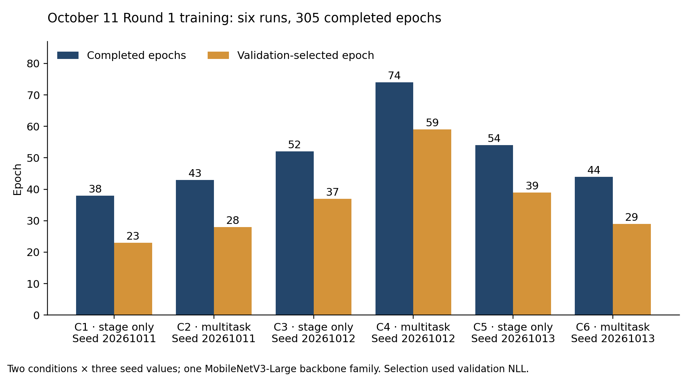
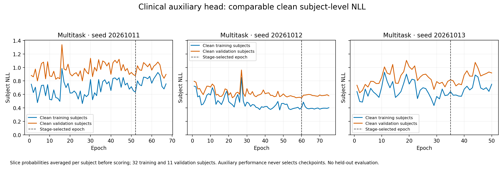

# Dementia MRI Training and Benchmark Results

Arman Kazi | STS manuscript Results | October 18 2026

Six MobileNetV3-Large training runs achieved 99.32% to 99.89% accuracy on the complete 5,450-image test split. The runs comprise two conditions with three seeds each and are archived as the October 11 Round 1 study. The full-test replay is descriptive and post hoc; the 1,058-image matched comparison retains its prespecified primary role. These image-level results do not establish patient-independent or clinical performance.

## Training and validation selection

Stage-only learned the four supplied image labels; multitask added a separate AD/control auxiliary head with a shared backbone. Both conditions used seeds 20261011, 20261012 and 20261013, completing 305 epochs in total. All six runs stopped under the 15-epoch patience rule before the 100-epoch cap. Checkpoints were selected by validation negative log-likelihood with a required improvement greater than 0.0001. The validation-only preference was stage-only, represented by seed 20261012 at epoch 37; no test result was used to change this preference.

Table 1. Completed training and validation-selected checkpoints.

| Run | Condition | Seed | Completed | Selected | Val NLL |
| --- | --- | --- | --- | --- | --- |
| C1 | Stage only | 20261011 | 38 | 23 | 0.037472 |
| C2 | Multitask | 20261011 | 43 | 28 | 0.051601 |
| C3 | Stage only | 20261012 | 52 | 37 | 0.034771 |
| C4 | Multitask | 20261012 | 74 | 59 | 0.045311 |
| C5 | Stage only | 20261013 | 54 | 39 | 0.036942 |
| C6 | Multitask | 20261013 | 44 | 29 | 0.054033 |

Figure 1. Actual completed epochs and selected checkpoint epochs for the six runs. These are two conditions across three seeds, not six architectures. C1 to C6 correspond to Table 1.

## Complete test split of 5450 images

The legacy collection contained 44,000 upstream-augmented JPEG images. Group-based exclusions removed 1,863 rows connected to the historical 100-image benchmark and 14,959 rows in mixed-label similarity groups, leaving 27,178 images: 19,023 training, 2,705 validation and 5,450 test. The exclusions do not establish that the supplied labels were wrong. Exact-pixel and identical-dHash connected groups were kept within one split; patient and original augmentation-family identities remain unavailable.

The complete test split contained 1,342 MildDemented, 1,538 ModerateDemented, 1,324 NonDemented and 1,246 VeryMildDemented images. Table 2 was recomputed from each frozen checkpoint’s saved full-test prediction CSV and checked against the archived replay metrics. No retraining, checkpoint reselection or new inference was used to recompute these historical results.

Table 2. Complete test split performance for all six selected checkpoints.

| Model | Correct / n | Errors | Acc % | BA % | F1 % |
| --- | --- | --- | --- | --- | --- |
| Stage 11 | 5,438/5,450 | 12 | 99.78 | 99.77 | 99.77 |
| Multitask 11 | 5,413/5,450 | 37 | 99.32 | 99.27 | 99.29 |
| Stage 12 | 5,443/5,450 | 7 | 99.87 | 99.87 | 99.87 |
| Multitask 12 | 5,435/5,450 | 15 | 99.72 | 99.71 | 99.71 |
| Stage 13 | 5,444/5,450 | 6 | 99.89 | 99.88 | 99.88 |
| Multitask 13 | 5,428/5,450 | 22 | 99.60 | 99.58 | 99.58 |

Acc denotes accuracy; BA is the mean recall across the four supplied classes; F1 is macro-averaged F1. Model suffixes 11, 12 and 13 denote the final two digits of the full seeds in Table 1. Stage-only accuracies were 99.78%, 99.87% and 99.89%; multitask accuracies were 99.32%, 99.72% and 99.60%. Across all six models, balanced accuracy ranged from 99.27% to 99.88% and macro F1 from 99.29% to 99.88%.

The validation-preferred representative, Stage 12, correctly classified 5,443/5,450 images, with 99.87% accuracy, 99.87% balanced accuracy and 99.87% macro F1. Stage 13 had one fewer observed error, but this post-hoc test difference does not replace the validation-selected representative.

## Relationship to the matched comparison

The replay protocol explicitly identifies the full 5,450-image evaluation as a post-hoc supplement that contains the primary 1,058-image subset. It therefore supplies a broader descriptive assessment of the six new checkpoints, not an additional independent cohort. Under the old baseline split, these 5,450 images comprise 3,860 training, 532 validation and 1,058 test rows; a baseline comparison on all 5,450 would mix previously seen and held-out images.

The historical full-test replay did not provide paired uncertainty estimates for this complete cohort. Table 2 therefore reports point estimates only. Detailed per-class counts and all confusion matrices accompany the reproducible analysis in the repository.

## Matched comparison and sensitivity analysis

The prespecified matched comparison used the same 1,058 exact image rows for the old baseline and all six new checkpoints, representing 966 prepared similarity groups. Of those images, 302 had a similarity-group mate in old training or validation. Excluding those groups yielded the prespecified 756-image sensitivity subset in 733 groups. The smaller subset changes sample composition and does not establish patient independence.

Table 3. Correct classifications and accuracy on the matched and historical benchmarks.

| Model | Matched 1058 | Sensitivity 756 | Reused 100 |
| --- | --- | --- | --- |
| Old baseline | 1057/1058 (99.91%) | 755/756 (99.87%) | 100/100 (100.00%) |
| Stage 11 | 1055/1058 (99.72%) | 753/756 (99.60%) | 99/100 (99.00%) |
| Multitask 11 | 1054/1058 (99.62%) | 752/756 (99.47%) | 100/100 (100.00%) |
| Stage 12 | 1057/1058 (99.91%) | 755/756 (99.87%) | 100/100 (100.00%) |
| Multitask 12 | 1056/1058 (99.81%) | 754/756 (99.74%) | 99/100 (99.00%) |
| Stage 13 | 1057/1058 (99.91%) | 755/756 (99.87%) | 100/100 (100.00%) |
| Multitask 13 | 1055/1058 (99.72%) | 754/756 (99.74%) | 99/100 (99.00%) |
| Stage ensemble | 1058/1058 (100.00%) | 756/756 (100.00%) | 100/100 (100.00%) |
| Multitask ensemble | 1056/1058 (99.81%) | 754/756 (99.74%) | 100/100 (100.00%) |

Individual-model accuracy ranged from 99.62% to 99.91% in the matched comparison and 99.47% to 99.87% in the sensitivity analysis. The stage-only ensemble averaged the three frozen probability vectors uniformly and achieved 1,058/1,058 and 756/756 correct classifications. The multitask stage ensemble achieved 1,056/1,058 and 754/756. Ensemble membership, weights and thresholds were not fitted to these test results.

The frozen analysis used 2,000 paired percentile bootstrap resamples of similarity groups. For the validation-preferred Stage 12 model versus the baseline, the matched accuracy difference was 0.00 percentage points (95% interval -0.29 to +0.28); the sensitivity difference was 0.00 (-0.40 to +0.40). These estimates do not demonstrate a performance improvement. Intervals are exploratory, unadjusted for multiplicity and conditional on the available images and grouping; they exclude uncertainty from training and source selection.

## Reused historical benchmark

The old baseline, Stage 12, Stage 13, Multitask 11 and both ensembles correctly classified all 100 historical benchmark images; the other three single checkpoints scored 99/100. Of these 100 images, 66 match old training rows, nine old validation rows and 25 old test rows. This is reused descriptive evidence. Perfect observed accuracy and degenerate bootstrap intervals do not imply population certainty or clinical superiority.

## Benchmark comparison and original figures

Figure 2. Accuracy for the exact-row matched comparison, its similarity-exclusion subset and the reused historical benchmark. The sensitivity subset overlaps the matched cohort, and the historical images are reused. The narrowed horizontal scale makes small differences visible; Table 3 gives the counts and denominators.

## Interpretation

The results show high agreement with four supplied image labels within this legacy dataset. Upstream augmentation, unknown patient identities and unverified augmentation-family relationships limit generalization claims. The four labels are not a validated mapping to clinical CDR stages. Similarity exclusion cannot remove unknown relationships or prove that every image was equally unseen by the old and new models. Clinical AD/control results require separate endpoints and participant-level evidence; they are not inferred from these four-class percentages.

The earlier specialist histories are separate from the six October 11 runs summarized here. The 305-epoch total must not be attributed to six architectures, to 18 runs, or to the older specialist checkpoint. The manuscript emphasizes the six-run development study and complete test split while retaining the original primary-versus-supplementary analysis roles.

## Source records and original GitHub figures

- [Training histories and completed Methods](https://github.com/TailsOS-hack/Dementia-Paper/blob/84c1d731154d12103abf1adce5a57ad6f7bb6b8a/docs/kevin_paper_20261011/publication/reports/Completed_Methods.md)
- [Frozen validation selection and analysis protocol](https://github.com/TailsOS-hack/Dementia-Paper/blob/84c1d731154d12103abf1adce5a57ad6f7bb6b8a/docs/kevin_paper_20261011/publication/results/validation_selection.json)
- [Full-test replay protocol and cohort role](https://github.com/TailsOS-hack/Dementia-Paper/blob/84c1d731154d12103abf1adce5a57ad6f7bb6b8a/docs/kevin_paper_20261011/publication/figures/clean_replay/protocol_before_inference.json)
- [Original full-test confusion matrices](https://github.com/TailsOS-hack/Dementia-Paper/blob/84c1d731154d12103abf1adce5a57ad6f7bb6b8a/docs/kevin_paper_20261011/publication/figures/quantitative/full_new_test_confusion_all_six.png)
- [Original six-run loss curves](https://github.com/TailsOS-hack/Dementia-Paper/blob/84c1d731154d12103abf1adce5a57ad6f7bb6b8a/docs/kevin_paper_20261011/publication/figures/quantitative/stage_loss_all_six_runs.png)
- [Original paired accuracy intervals](https://github.com/TailsOS-hack/Dementia-Paper/blob/84c1d731154d12103abf1adce5a57ad6f7bb6b8a/docs/kevin_paper_20261011/publication/figures/quantitative/paired_accuracy_differences.png)
- [Original two-condition architecture figure](https://github.com/TailsOS-hack/Dementia-Paper/blob/84c1d731154d12103abf1adce5a57ad6f7bb6b8a/docs/kevin_paper_20261011/publication/figures/quantitative/dementia_two_condition_architecture.png)
- [Complete matched statistics and historical benchmark](https://github.com/TailsOS-hack/Dementia-Paper/blob/84c1d731154d12103abf1adce5a57ad6f7bb6b8a/docs/kevin_paper_20261011/publication/reports/Full_Results.md)
## New retraining with comparable learning curves

A separate October 18 experiment completed 6 runs and 329 epochs, using stage-only and multitask conditions with three seeds each. At every epoch end, the same fixed checkpoint was evaluated on all 19,023 training and 2,705 validation images with the same clean transform, evaluation mode and unweighted, unsmoothed negative log-likelihood (NLL). Table 4 and Figure 3 report these new measurements; Tables 1 to 3 retain the historical October 11 results.

Table 4. New retraining epochs and clean NLL at the validation-selected checkpoint.

| Condition | Seed | Completed | Selected | Train NLL | Val NLL |
| --- | --- | --- | --- | --- | --- |
| Stage only | 20261011 | 42 | 27 | 0.034431 | 0.036154 |
| Multitask | 20261011 | 67 | 52 | 0.041157 | 0.045978 |
| Stage only | 20261012 | 55 | 40 | 0.035196 | 0.037724 |
| Multitask | 20261012 | 75 | 60 | 0.042489 | 0.048810 |
| Stage only | 20261013 | 40 | 25 | 0.035889 | 0.038450 |
| Multitask | 20261013 | 50 | 35 | 0.044689 | 0.049141 |

Figure 3. New epoch-end clean training and validation NLL for all six runs. Dashed lines identify validation-selected checkpoints. Both curves use the same measurement procedure; training remains resubstitution. Raw observations are shown without smoothing or interpolation.

## Clinical auxiliary curves and interpretation

For the multitask runs, clinical loss was calculated after averaging slice probabilities within each subject: 32 training subjects and 11 validation subjects. These clean subject-level curves use the same evaluation procedure across splits. Clinical loss did not select the stage checkpoint.

Figure 4. New clean clinical auxiliary NLL for the three multitask seeds, scored after subject-level probability aggregation. Dashed lines show the epoch selected by stage-validation NLL. No held-out or external clinical result is presented.

## Training controls and validation selection

The verified training configuration used a maximum of 100 epochs, a minimum of 20, patience of 15 epochs and a required validation-NLL improvement greater than 0.0001. Inputs were 224 by 224 pixels with batch size 32. AdamW used learning rate 0.0001 and weight decay 0.001; label smoothing was 0.05. The multitask auxiliary objective had weight 0.25 and was added every 4 stage batches.

The validation-only preferred condition was stage-only; its representative used seed 20261011 and epoch 27. This preference used mean selected stage-validation NLL across the three seeds and then the lowest validation NLL within that condition. All six runs remain reported. Online training NLL measured augmented images with changing parameters; the weighted, smoothed optimization objective was logged separately and is not substituted for the clean NLL curves.

## Evidence boundaries and provenance

Training loss is resubstitution, and validation was used for selection. These new learning curves do not supply independent test performance, demonstrate clinical superiority or establish readiness for clinical use. They do not revise the historical benchmark estimates. Image-similarity groups do not establish patient independence, and the clinical training and validation samples remain small.

The source report checked all six completed histories, per-epoch clean evaluation records, denominators, stopping decisions and validation-only selection. All 12 retrieved checkpoint file hashes were verified. Stage and clinical manifest IDs and group separation were independently checked. The machine-readable report records source hashes; the appended figures were checked against its figure hashes. Report SHA256 begins 80a7bedf6a3d273e; full provenance is retained in report.json and summary.csv.
